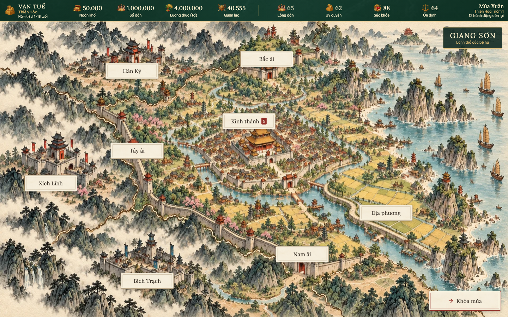
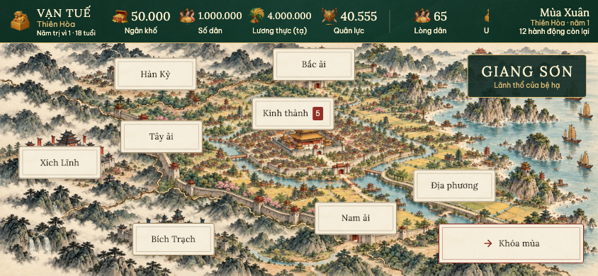

# Giang Sơn — bản đồ quốc gia

Giang Sơn thay màn Hoàng thành và là màn mặc định khi mở bản lưu, bắt đầu hoặc tiếp tục một triều đại. Route nội bộ `citadel` giữ nguyên để tương thích các luồng điều hướng cũ.

- Bản đồ giữ bố cục [mockup đã duyệt](../output/giang-son-mockup/giang-son-mockup.png), vẽ lại theo phong cách tranh minh họa cổ phong Việt Nam bằng màu nước và mực trên giấy ngà. Hoàng cung nằm trong Kinh thành; ruộng và đê dọc sông; ba tuyến tường thành có Bắc ải, Tây ải, Nam ải. Hàn Kỳ ở phía bắc, Xích Lĩnh ở phía tây, Bích Trạch ở phía nam; mỗi nước có một tòa thành và tên.
- Bấm **Kinh thành** mở trang riêng (`capital`), với Tử Cấm Thành, phố chợ tấp nập và kiến trúc xung quanh, vẽ bằng màu nước và mực trên giấy ngà. Bảy nhãn công trình là Điện Vĩnh An (tấu chương), Ngân khố, Phủ Bá Quan (triều thần), Cung Ngọc Hoa (hậu cung), Điện Dưỡng Tâm (long thể), Viện Quốc Sử (sử ký) và Vọng Thiên Các (thành tích). Bỏ nút Quốc sự khỏi cảnh Kinh Thành. Số tấu chương chờ hiện cạnh Điện Vĩnh An. Nút **Giang Sơn** quay lại bản đồ. Khi hết hành động, **Chong đèn làm thêm** hiện ở góc trái. Trang dùng chung HUD và luồng Khóa mùa/Sang tuần. Màn hẹp kéo ngang; cửa sổ thấp cuộn dọc thêm để xem đủ các công trình.
- Bỏ nút Kinh thành cũ ở cổng thành. **Địa phương** (nút Ruộng · Đê điều trước đây) mở [toàn cảnh làng quê riêng](locality.md) với sáu điểm đến; các biên ải và nước láng giềng mở Quân sự, hoặc Quốc sự với bản lưu cũ. Dân cư & Lao động vẫn truy cập qua chỉ số Số dân trên HUD web.
- Bỏ toàn bộ thanh điều hướng dưới bản đồ. Nút **Khóa mùa** nổi ở góc dưới bên phải; bản lưu tuần vẫn dùng **Sang tuần**. Nút bị khóa khi đang lưu và vẫn gọi luồng xác nhận tấu tới hạn/quốc sự trước khi chuyển kỳ.
- Giang Sơn giữ đủ tám chỉ số: Ngân khố, Số dân, Lương thực, Quân lực, Lòng dân, Uy quyền, Sức khỏe, Ổn định. HUD luôn dùng một hàng, cao khoảng 60 px ở cỡ chữ thường; khi cửa sổ hẹp, dãy chỉ số cuộn ngang, lịch và số hành động giữ bên phải. Chiều cao thích ứng khi tăng cỡ chữ. Web và các kích thước mobile dùng cùng HUD. Số dân lấy từ `state.population.population`; lương thực từ `state.grain`, kèm đơn vị của bản lưu. Bản lưu cũ chưa có dân số hiện “—”. Tooltip hiện số đầy đủ; bấm Số dân mở Dân cư & Lao động (Quốc sự với bản lưu cũ), bấm Lương thực mở Ngân khố. Các trang khác chỉ hiện chỉ số liên quan; Sử ký, Thành tích và chi tiết nhân vật không hiện dải chỉ số toàn quốc. Đã bỏ menu trái, drawer và nút hamburger; các trang dùng nút về trang cha khi chưa có nút điều hướng sẵn. Sử ký và Thành tích vẫn có lối vào tại Viện Quốc Sử và Vọng Thiên Các. Xem [bảng chỉ số và điều hướng](context-hud.md).
- Màn ngang hiển thị toàn bản đồ. Màn hẹp giữ tỷ lệ tranh và kéo ngang được bằng cảm ứng, chuột hoặc trackpad; nhãn nằm trên cùng canvas với công trình. Tiêu đề chuyển lên HUD trên màn hẹp để không che Bắc ải. Điểm bấm có chiều cao tối thiểu 44 px.
- Các nút địa danh và nút Khóa mùa/Sang tuần dùng nền giấy ngà có vân giấy, chữ mực nâu đen, viền kép mảnh và bóng nhẹ. Số tấu chương giữ dạng dấu son; nút chuyển kỳ có viền son và mũi tên. Hover, focus và nhấn dùng sắc mực/son nhẹ để đồng bộ với tranh màu nước.
- Thay đổi thuộc giao diện và tài nguyên; không sửa engine, luật, phiên bản điểm số hoặc dữ liệu bản lưu.

## Tệp chính

- `lib/game/presentation/widgets/citadel_hub.dart`: bản đồ quốc gia, nhãn công trình, HUD và nút nổi.
- `lib/game/presentation/widgets/web_game_hud.dart`: HUD dùng chung cho Giang Sơn và các trang chức năng trên web, kể cả khi cửa sổ thu hẹp dưới 720 px.
- `lib/game/presentation/game_app.dart`: nhóm chỉ số và nút về trang cha, không còn danh mục bên trái.
- `assets/images/giang-son-map.webp`: tranh nền không chữ, 1922 × 818, khoảng 555 KiB; được đóng gói trong `pubspec.yaml`.
- `test/citadel_hub_test.dart`: điều hướng và thao tác trên năm kích thước; không tiêu hành động khi xem; tương thích bản lưu cũ/mới; hủy xác nhận và lưu một kỳ; khóa thao tác khi đang lưu.
- `tools/giang_son_visual_test.dart`: render widget thật với font và ảnh đóng gói, xuất ảnh ở 1440 × 900, 1280 × 720, 1024 × 768, 844 × 390, 390 × 844 và 320 × 568.

## Nguồn ảnh

Tranh nền được vẽ lại từ bản đồ hiện có bằng **image_gen tích hợp**, với màu nước, nét mực và chất giấy ngà, giữ bố cục công trình, địa hình và biên giới. Các nhãn trong game là widget tương tác, không nằm trong tranh. Chuyển PNG sang WebP chất lượng 88 bằng `cwebp`, giữ kích thước 1922 × 818. Không tải ảnh mạng khi chơi.

Prompt vẽ lại đầy đủ: [background-prompt.txt](../output/giang-son-watercolor/background-prompt.txt).

## Kiểm tra

- Phân tích: `flutter analyze`.
- Bộ kiểm thử: `flutter test --reporter expanded`.
- Ảnh thực tế: `flutter test tools/giang_son_visual_test.dart --reporter expanded`.
- Build: `flutter build web --release --no-web-resources-cdn`.

Kết quả chạy được lưu trong `output/giang-son-implementation/`; riêng cập nhật HUD web ở `output/web-hud/`.

Kết quả ngày 31/10/2026: `flutter analyze` không có lỗi/cảnh báo; 759 kiểm thử đạt; 6 kiểm tra render đạt; build web release thành công. Đã kiểm tra bản release trong trình duyệt với bản lưu đang có: mở Hoàng cung → Ngân khố → Về Giang Sơn, giữ nguyên 12 hành động và các chỉ số. Bản local được phục vụ tại `http://127.0.0.1:4173`.

Cập nhật HUD web được kiểm tra với cả bản lưu cũ/mới: điều hướng không đổi dữ liệu, số dân/lương thực cập nhật sau khi tải trạng thái. Cập nhật theo ngữ cảnh dùng chung HUD cho web/mobile và bỏ menu trái; xem [kiểm tra và ảnh mới](context-hud.md).

## Trang Kinh Thành

- `lib/game/presentation/widgets/capital_hub.dart`: cảnh thành phố, bảy điểm điều hướng, nút quay về, HUD, Khóa mùa và làm thêm.
- `assets/images/kinh-thanh-watercolor-v2.webp`: nền không chữ, 1536 × 1024, khoảng 828 KiB, tạo bằng image_gen tích hợp, chuyển WebP chất lượng 90, đóng gói và dùng offline.
- [Prompt đầy đủ](../output/kinh-thanh-layout-v2/background-prompt.txt).
- `tools/capital_visual_test.dart`: render cảnh thực tế trên năm kích thước từ 320 × 568 đến 1440 × 900.
- [Ảnh desktop](../output/kinh-thanh-layout-v2/capital-1440x900.png) · [Ảnh màn hẹp](../output/kinh-thanh-layout-v2/capital-390x844.png).
- Điều hướng chỉ đổi màn hình, không tiêu hành động và không ghi lại trạng thái.

Log kiểm tra cập nhật Kinh Thành nằm tại `output/kinh-thanh-implementation/`.

Kiểm tra Kinh Thành bản đầu ngày 31/10/2026: 49 kiểm thử đạt (điều hướng, trạng thái, HUD, màn chức năng và 5 bản render); `flutter analyze` không có lỗi; build web release thành công. Đã kiểm tra bản release trong trình duyệt với bản lưu cũ: Giang Sơn → Kinh Thành hiển thị đủ tám điểm đến trong cây truy cập, giữ 12 hành động và các chỉ số. Ảnh trình duyệt: [browser-capital.png](../output/kinh-thanh-implementation/browser-capital.png).

### Bố trí công trình và tên địa điểm

Bản nền v2 phân định rõ tường Tử Cấm Thành với phố phường bên ngoài. Điện Vĩnh An, Cung Ngọc Hoa, Ngân khố và Điện Dưỡng Tâm nằm trong tường cung. Phủ Bá Quan nằm ở khu hành chính ngoài cung; Viện Quốc Sử và Vọng Thiên Các có công trình riêng trong khu đô thị. Tên địa điểm thay tên chức năng trên bảy nút; tooltip giải thích chức năng khi rê chuột hoặc nhấn giữ.

Tọa độ đặt tại đầu chấm chỉ dẫn trên mái công trình. Nhãn và đường chỉ dẫn đi cùng tranh khi cuộn hoặc thay đổi kích thước; không ép nhãn về mép khung nhìn khiến chấm trỏ lệch. Nút dài dùng khung 180 px. Quốc sự được gỡ khỏi danh sách điểm đến trong Kinh Thành.

Prompt, ảnh render và log kiểm tra bản bố trí v2 nằm trong `output/kinh-thanh-layout-v2/`.

Kiểm tra bản bố trí v2 ngày 31/10/2026: 49 kiểm thử đạt, gồm 5 bản render ở 1440 × 900, 1024 × 768, 844 × 390, 390 × 844 và 320 × 568; phân tích không có lỗi; build web release thành công. Đã xác nhận bảy tên mới, không có nút Quốc sự và cả bảy đầu chấm trỏ đúng mái nhà trong trình duyệt. Bản lưu cũ giữ nguyên 12 hành động và các chỉ số khi chuyển từ Giang Sơn sang Kinh Thành. [Ảnh trình duyệt v2](../output/kinh-thanh-layout-v2/browser-capital.png).
