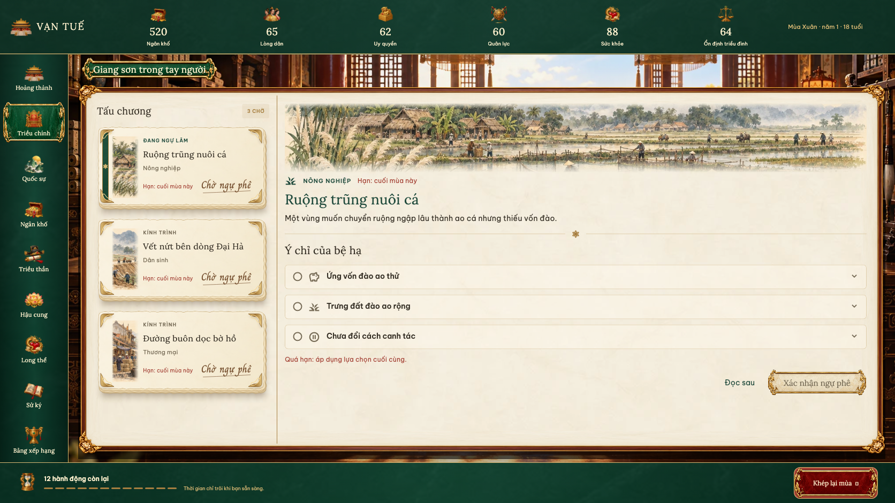
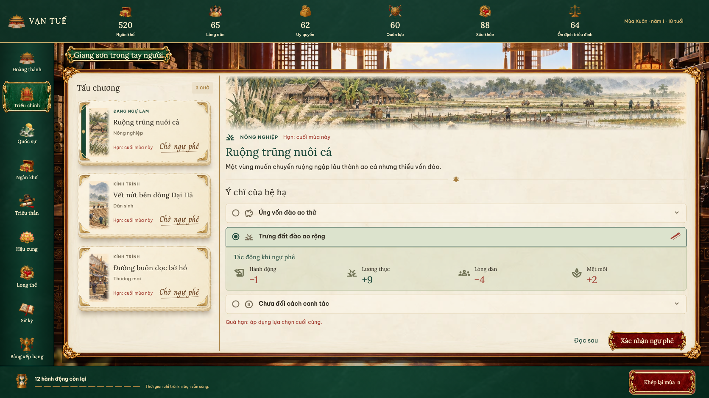
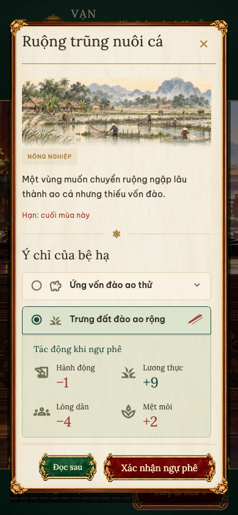
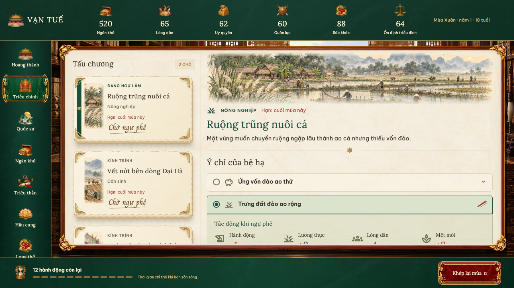
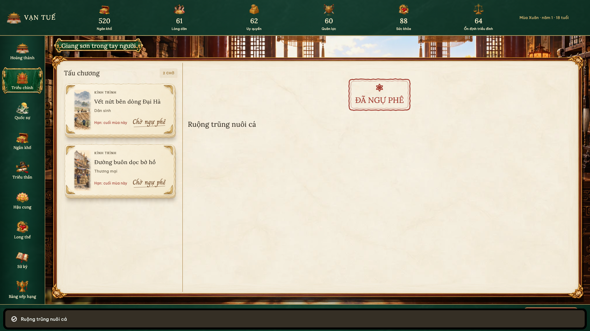
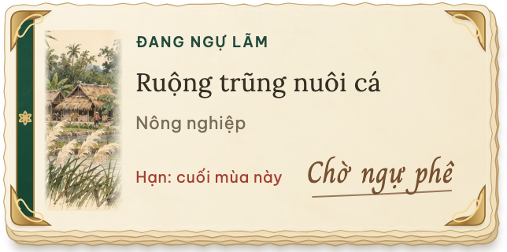

# Triều chính — đọc và ngự phê trong hai vùng

Màn rộng có danh sách tấu gọn ở bên trái và vùng đọc/ngự phê ở bên phải. Mỗi mục trong danh sách là một công văn trên giấy, có dòng “Kính trình”, tên, loại tấu, hạn xử lý và nét mực nâu viết tay “Chờ ngự phê”; không có nút ngự phê riêng trên công văn. Bấm vào toàn bộ tờ giấy để mở nội dung. Công văn đang mở có dải đánh dấu ngọc và dòng “Đang ngự lãm”. Bỏ đoạn trích trùng với nội dung đang đọc. Chọn bản tấu đưa vùng đọc về đầu trang. Phần cảnh nền phía trên được thu ngắn để dành chỗ cho nội dung. Hình thức công văn dùng ba lớp giấy lệch nhau, mép giấy không đều, bóng nhẹ, góc đồng chạm nét, tranh nhỏ theo chủ đề và dải ngọc; nội dung được dựng bằng widget, giữ thẳng, đọc được và thao tác bằng bàn phím/trợ năng. Đầu bản tấu có tranh thủy mặc theo nhóm nông nghiệp, sông/đê, thương mại hoặc cung đình. Tranh là tài nguyên trang trí; chữ, nút, dấu, trạng thái và số liệu vẫn là Flutter thật. “Chờ ngự phê” dùng font Charm với nét gạch mực mảnh, không có khung dấu đỏ. Font được đóng gói nội bộ và dùng khi offline; nguồn [Google Fonts/Charm](https://github.com/google/fonts/tree/main/ofl/charm), kèm giấy phép `assets/fonts/Charm-OFL.txt`. Sau xác nhận, dấu son “ĐÃ NGỰ PHÊ” xuất hiện ở trang xác nhận khi vẫn còn bản tấu khác; hết tấu tiếp tục hiện trạng thái hoàn tất. Mép giấy, các lớp, góc đồng, nét gạch và khung dấu được vẽ bằng Flutter Canvas, giữ chữ thẳng và đọc được.

Ô chọn chỉ hiển thị tên hành động, cả trước và sau khi chọn. Chọn phương án mới mở thông tin ngay bên dưới: chi phí tiền/lương thực, số hành động, tác động, thông tin kinh tế, thời hạn và phần giao người nếu được phép. Các tác động tức thì hiện thành biểu tượng, nhãn và số có dấu trong khối xanh ngọc nhạt. Chỉ dùng chi phí và hiệu ứng của phương án đã được giải quyết theo luật mùa/tuần hiện tại; không cộng trước phần thưởng có điều kiện hoặc đến sau. Diễn giải số đã có trong bảng tác động được lược khỏi phần văn bản; các hiệu ứng đặc biệt, thời hạn và rủi ro vẫn giữ. Các thông tin này chỉ hiện trong phần chi tiết; người phụ trách và xác suất hiện tại được hiển thị tại khu giao người. Kết quả đến sau được phân biệt với tác động tức thì. Đổi phương án đóng chi tiết cũ và bỏ người đã chọn cho phương án cũ. Các phương án thiếu tài nguyên hoặc không đáp ứng điều kiện có lý do hiển thị bên dưới.

Hạn xử lý và cảnh báo quá hạn vẫn hiện. Vùng đọc kết thúc ngay sau phần ngự phê; bỏ các khối thế cục, việc vua, sức khỏe, sử ký, thu/chi và câu nhắc ghi vào sử ở cuối trang. Triều chính chỉ giữ cảnh báo ngắn về chỉ số nguy cấp, bỏ bê việc nước, long thể hoặc đại biến cố đang diễn ra, kèm lối tới khu xử lý. HUD và thanh khép mùa giữ vị trí khi cuộn. Trên màn hẹp, chọn tấu mở hộp đọc với cùng cách thu gọn/mở chi tiết.

Khi không còn tấu, hiển thị “Đã xử lý hết tấu chương mùa/tuần này” cùng hai nút “Đến Quốc sự” và “Về Hoàng thành”. Chấn chỉnh và cứu tế nằm tại Quốc sự; dưỡng sức, yến tiệc, chữa trị và các chỉ số nhịp sống nằm tại Long thể. Sổ tiền ở Ngân khố, biên niên ở Sử ký. Quốc sự chỉ giữ ban hành công việc, tiến độ đang thực hiện, nghĩa vụ và ảnh hưởng đang hiệu lực, đối sách khẩn cấp và kết quả đã nhận. Các khối thế cục, đại biến cố, chuỗi tấu chương, lịch và lịch sử đại biến cố cùng nút “Luật thế cục” đã được bỏ khỏi Quốc sự. Cảnh báo đại biến cố dạng tấu chương dẫn về Triều chính để ngự phê.

Các kết quả chưa được xác nhận đã đọc được gom thành nút “Kết quả mới (N)” tại Triều chính. Đóng hộp báo cáo đánh dấu các báo cáo vừa mở là đã đọc; các báo cáo khác vẫn chưa đọc. Dấu đọc được lưu riêng theo lượt trị vì trong IndexedDB `van-tue-interface`, không ghi vào archive/schema trò chơi. Trạng thái này được giữ khi tải lại; khi trình duyệt không cho lưu tùy chọn giao diện, vẫn đọc báo cáo bình thường và giữ dấu trong bộ nhớ của phiên. Popup kết quả sau hành động/khép mùa và báo cáo trước kết thúc triều đại tiếp tục hoạt động; lịch sử báo cáo vẫn có ở Quốc sự.

Chọn tấu, chọn phương án, giao người và “Đọc sau” chỉ thay đổi trạng thái giao diện. Nút “Xác nhận ngự phê” tiếp tục gửi lệnh hiện có. Không thay đổi định nghĩa sự kiện, chi phí, xác suất, hiệu ứng, quyết toán, luật mùa/tuần, phiên bản luật hoặc schema bản lưu.

## Xác minh

- `flutter test --reporter expanded`: 616 bài kiểm tra đạt, gồm ngự phê chỉ ghi sau xác nhận, giao người, kinh tế tấu chương, quyết toán chuỗi, lưu/tải và các màn hiện có.
- Kiểm tra mới ở 1440×900, 1280×720, 844×390, 760×600, 390×844 và 320×568: mở/đổi tấu, mở chi tiết, đổi phương án, đổi người, đóng/mở lại không đổi trạng thái trò chơi hoặc bản lưu.
- Hai bài kiểm tra chạy trên Chrome với IndexedDB thật: dấu đọc giữ qua mở lại, tách theo lượt trị vì và gộp đúng khi hai nơi ghi đồng thời.
- `flutter analyze`: không có vấn đề.
- `flutter build web --release`: thành công.
- SHA-256 của 45 tệp luật chơi, dữ liệu, mô hình, lưu trữ và controller được đối chiếu với trước thay đổi: không đổi.
- Hai bài kiểm tra bổ sung so sánh các số tác động được hiển thị với số thay đổi sau khi ngự phê thật và sau tải bản lưu trên desktop/mobile.
- Ba kiểm tra render Flutter ở 1672×940, 1280×720 và 390×844: dùng font, ảnh và widget thật; kiểm tra cả trước/sau chọn. Trình duyệt tích hợp bị tắt trong cài đặt Work ở lần cập nhật này; ảnh mới được render trực tiếp từ Flutter bằng `flutter test tools/court_visual_test.dart`, không phải ảnh concept.
- `tools/visual_preview.dart?room=court&example=memorial` tạo ba tấu mẫu trong bộ nhớ để xem bố cục; không đọc/ghi bản lưu người dùng.
- [Bốn tài nguyên tranh, nguồn và prompt imagegen đầy đủ](petition-watercolor-assets.json). Ảnh tạo bằng công cụ imagegen tích hợp; cắt bốn dải và xuất WebP quality 90, tổng dung lượng khoảng 609 KB.

## Ảnh thực tế

