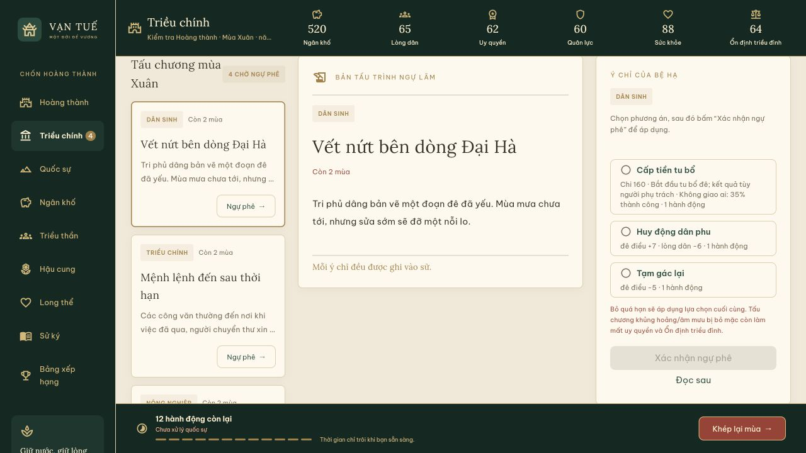
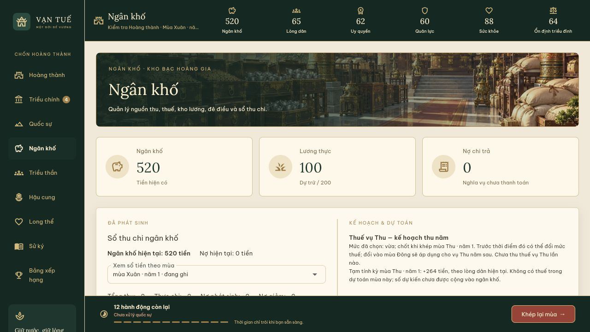
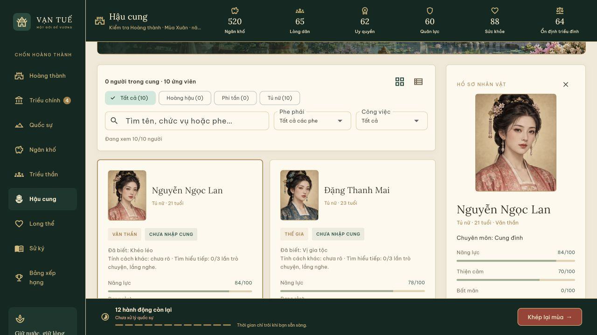
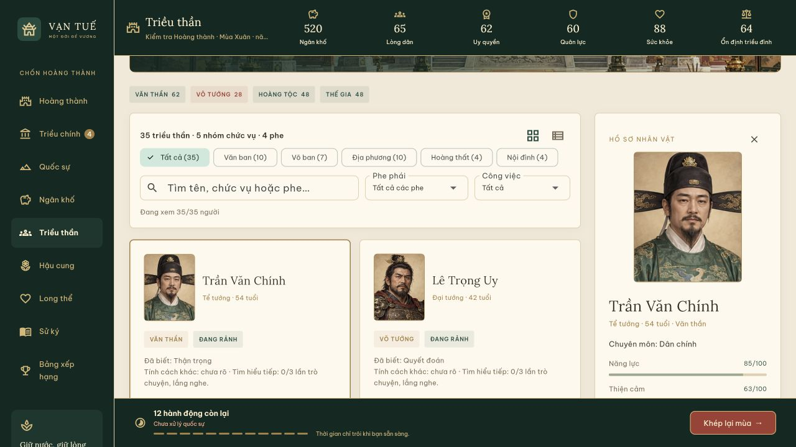
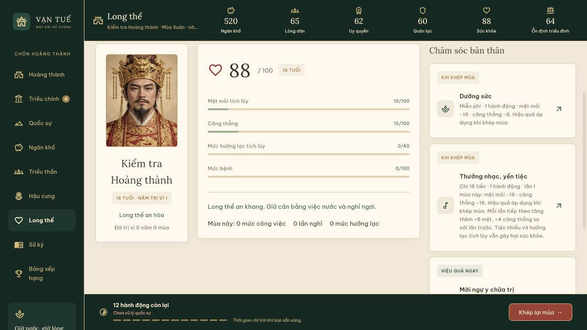

> Giao diện này đã được thay bằng [nội thất phẳng toàn phòng](flat-rooms.md). Ảnh bên dưới lưu bản thiết kế trước.

# Giao diện năm khu trong Hoàng thành

Triều chính, Ngân khố, Hậu cung, Triều thần và Long thể dùng chung thanh chỉ số, danh mục xanh ngọc và thanh hành động cuối màn. Mỗi khu có một cảnh riêng, nội dung đặt trên giấy ngà. Các trang mở từ đúng công trình của Hoàng thành.

## Các khu

- **Triều chính / Ngự thư phòng:** khi vùng nội dung rộng từ 980 px, danh sách bản tấu, nội dung đọc và lựa chọn ngự phê nằm cạnh nhau. Nhấn thân bản tấu để đọc tại bàn; nút Ngự phê vẫn mở hộp riêng. Màn hẹp dùng hộp ngự phê. Cả hai cách dùng chung `PetitionDecision`, cùng kiểm tra chi phí, thóc, hành động, phân công, quyết toán chuỗi và lệnh xác nhận. Chọn hoặc đổi phương án/người xử lý chưa ghi dữ liệu; chỉ Xác nhận ngự phê mới gửi lệnh. Thành công hiện dấu son.
- **Ngân khố / Kho bạc:** ba thẻ tiền, lương thực và nợ lấy số thật. Sổ mở hai trang khi đủ rộng: bên trái là giao dịch đã phát sinh, bên phải là thuế vụ Thu và dự toán. Chính sách thuế, ưu tiên ngân sách, nguồn thu chủ động, đê điều và công việc dài hạn vẫn dùng đúng callback cũ.
- **Hậu cung / Nội viện:** các nhóm Hoàng hậu, Phi tần, Tú nữ; thẻ chân dung, nhãn đã/chưa nhập cung, rảnh/bận, tìm kiếm, lọc phe và công việc. Chọn chân dung để mở hồ sơ cùng các hành động. Cung vụ, học tập và đóng góp vẫn là `PalacePanel` hiện có, ở cột bên khi đủ rộng và xếp trước danh sách trên màn hẹp.
- **Triều thần / Điện nghị sự:** huy hiệu thái độ bốn phe, lọc nhóm chức vụ/chuyên môn qua tìm kiếm, lọc rảnh/bận, chuyển thẻ chân dung sang danh sách so sánh. Hồ sơ chỉ dùng thông tin công khai và phẩm chất đã biết. Bước xác nhận bổ nhiệm trình người đương nhiệm cạnh ứng viên, giữ đầy đủ chi phí/cảnh báo/hậu quả cũ.
- **Long thể / Tẩm điện & Thái y viện:** chân dung hoàng đế, các chỉ số và báo cáo long thể, thẻ chăm sóc phân biệt hiệu quả ngay và khi khép kỳ. Nhấn thân thẻ chỉ xem trước; nút mũi tên thực hiện hành động hiện có. Mô tả dùng chung hàm tạo thông tin với thẻ nên luôn theo chi phí hỗ trợ và số lần đã thực hiện.

## Ranh giới hành vi

Không sửa `lib/game/logic`, `lib/game/models`, `lib/game/data` hoặc `GameController`. Không đổi schema, phiên bản luật, số hành động, mức phí, xác suất, RNG, tiến độ, cách lưu hay bảng điểm. Các lựa chọn UI như bản tấu đang đọc, người đang xem hồ sơ, chế độ thẻ/danh sách và chăm sóc đang xem trước chỉ nằm trong trạng thái giao diện. Không suy đoán hay công bố phẩm chất ẩn từ chân dung. Trạng thái bận sử dụng `officerBusy` có sẵn.

Chân dung là bộ **16 mẫu minh họa** (8 nam, 8 nữ), tái sử dụng ổn định theo ID/vai trò công khai; chưa phải chân dung độc quyền cho từng nhân vật. Atlas được lấy từng ô tại runtime, không có các tệp cắt rời. Cảnh hiện là tranh tĩnh. Ảnh đóng gói cùng bản web để chơi ngoại tuyến; không tải từ dịch vụ bên ngoài khi chơi.

## Tệp triển khai

- `lib/game/presentation/game_app.dart`: bố cục và nối các callback hiện tại.
- `lib/game/presentation/widgets/imperial_theme.dart`: màu, giấy nền, nhãn.
- `lib/game/presentation/widgets/imperial_widgets.dart`: HUD, cảnh tiêu đề, chân dung, thẻ tài nguyên, bố cục đáp ứng.
- `lib/game/presentation/widgets/petition_decision.dart`: biểu mẫu quyết định dùng chung giữa bàn đọc và hộp ngự phê.
- `lib/game/presentation/widgets/finance_panel.dart`: sổ tiền đã phát sinh và trang dự toán.
- `test/imperial_interiors_ui_test.dart`: kiểm tra bố cục, không ghi dữ liệu khi xem trước, xác nhận tại bàn đọc và hành động từ hồ sơ.

## Kiểm tra hoàn tất

- `flutter analyze`: không có vấn đề.
- `flutter test`: **557 kiểm thử đạt**, gồm 29 kiểm thử mới cho các khu. Các kiểm thử chỉ dành cho browser (`@TestOn('browser')`) không nằm trong lượt VM này.
- Kiểm tra năm khu ở 1440 × 900, 1280 × 720, 844 × 390, 390 × 844 và 320 × 568: không tràn bố cục, chỉ xem màn không làm đổi trạng thái trò chơi.
- Bàn đọc: chọn tấu/phương án/người xử lý chưa ghi; xác nhận mới ghi đúng một quyết định, cùng kết quả với luồng hộp ngự phê.
- Hồ sơ: đổi chế độ thẻ/danh sách không ghi; trò chuyện từ hồ sơ giữ đúng lệnh, chi phí hành động và dữ liệu lưu. Các phẩm chất chưa xác minh vẫn dùng nhãn chưa xác minh.
- Long thể: xem trước không tiêu hành động/tiền; các kiểm thử chăm sóc cũ tiếp tục kiểm tra hiệu quả tức thì/cuối kỳ và mức phí có hỗ trợ.
- Xác nhận bổ nhiệm có so sánh hai người và vẫn chạy được ở desktop/mobile.
- `flutter build web --release --no-web-resources-cdn`: thành công. Kiểm tra trực tiếp bản release tại 1280 × 720, chuyển năm khu, đọc tấu và mở hồ sơ; ngân khố, hành động và các chỉ số của lượt kiểm tra giữ nguyên khi chỉ điều hướng.

## Ảnh trong bản game

Các ảnh bên dưới là ảnh chụp bản release, không phải concept.

### Triều chính



### Ngân khố



### Hậu cung



### Triều thần



### Long thể



## Tài nguyên và prompt

Tạo bằng **image_gen tích hợp**. Năm cảnh dùng `assets/images/citadel-landscape.webp` làm tham chiếu phong cách; đây là ảnh mới, không thay thế tranh Hoàng thành. Chuyển PNG sang WebP chất lượng 84; atlas chất lượng 88. Bản gốc giữ tại thư mục generated_images, bản tiêu thụ nằm trong workspace.

### assets/images/court-interior.webp

```text
Use case: stylized-concept. Asset type: production background illustration for Vạn Tuế, Vietnamese imperial ruler simulation game. Reference image is STYLE REFERENCE ONLY, matching this same rich hand-painted semi-realistic palace world. Create ONE complete landscape 16:9 scene, no panels or collage. Scene: Imperial study, intimate wooden writing desk in foreground with brush rest, inkstone, jade imperial seal and neatly stacked folded petitions, no writing visible. Vermilion columns, silk mountain screen and shelves, warm morning light. Spacious room overlooking palace courtyard. Restrained jade green and antique gold. Composition: cinematic broad horizontal architectural view, coherent perspective, refined historic Vietnamese-inspired court setting, layered depth and believable props. Rich but restrained detail, readable silhouettes, realistic painterly materials and soft atmospheric lighting. This background will sit behind real UI panels and also be cropped into a scene header; keep main recognizable subject in center/right. No UI, no frames, no icons, no lettering, no calligraphy, no readable text, no watermark. Match the reference's quality and palette, not its exterior composition.
```

### assets/images/treasury-interior.webp

```text
Use case: stylized-concept. Asset type: production background illustration for Vạn Tuế, Vietnamese imperial ruler simulation game. Reference image is STYLE REFERENCE ONLY, matching this same rich hand-painted semi-realistic palace world. Create ONE complete landscape 16:9 scene, no panels or collage. Scene: Imperial treasury room with orderly wooden chests of copper coins, silver ingots, sacks of rice, abacus and open blank ledger on an accounting desk. Dark polished wood, warm brass details, wooden lattice windows with daylight. Wealth organized with dignity rather than mountains of treasure. Composition: cinematic broad horizontal architectural view, coherent perspective, refined historic Vietnamese-inspired court setting, layered depth and believable props. Rich but restrained detail, readable silhouettes, realistic painterly materials and soft atmospheric lighting. This background will sit behind real UI panels and also be cropped into a scene header; keep main recognizable subject in center/right. No UI, no frames, no icons, no lettering, no calligraphy, no readable text, no watermark. Match the reference's quality and palette, not its exterior composition.
```

### assets/images/harem-interior.webp

```text
Use case: stylized-concept. Asset type: production background illustration for Vạn Tuế, Vietnamese imperial ruler simulation game. Reference image is STYLE REFERENCE ONLY, matching this same rich hand-painted semi-realistic palace world. Create ONE complete landscape 16:9 scene, no panels or collage. Scene: Elegant imperial inner-palace veranda overlooking a lotus pond and flowering garden, layered silk curtains, carved wooden railing, cream stone, distant ochre tiled roofs. Soft jade, muted rose, warm gold. Calm and refined. No people. Composition: cinematic broad horizontal architectural view, coherent perspective, refined historic Vietnamese-inspired court setting, layered depth and believable props. Rich but restrained detail, readable silhouettes, realistic painterly materials and soft atmospheric lighting. This background will sit behind real UI panels and also be cropped into a scene header; keep main recognizable subject in center/right. No UI, no frames, no icons, no lettering, no calligraphy, no readable text, no watermark. Match the reference's quality and palette, not its exterior composition.
```

### assets/images/people-interior.webp

```text
Use case: stylized-concept. Asset type: production background illustration for Vạn Tuế, Vietnamese imperial ruler simulation game. Reference image is STYLE REFERENCE ONLY, matching this same rich hand-painted semi-realistic palace world. Create ONE complete landscape 16:9 scene, no panels or collage. Scene: Grand imperial council hall, symmetrical tall vermilion columns, gilded carved beams, broad throne dais in the background, side tables with blank scrolls and standing ceremonial screens. Deep jade, red wood and restrained antique gold. Eye-level wide view with dignified architectural depth. No people. Composition: cinematic broad horizontal architectural view, coherent perspective, refined historic Vietnamese-inspired court setting, layered depth and believable props. Rich but restrained detail, readable silhouettes, realistic painterly materials and soft atmospheric lighting. This background will sit behind real UI panels and also be cropped into a scene header; keep main recognizable subject in center/right. No UI, no frames, no icons, no lettering, no calligraphy, no readable text, no watermark. Match the reference's quality and palette, not its exterior composition.
```

### assets/images/health-interior.webp

```text
Use case: stylized-concept. Asset type: production background illustration for Vạn Tuế, Vietnamese imperial ruler simulation game. Reference image is STYLE REFERENCE ONLY, matching this same rich hand-painted semi-realistic palace world. Create ONE complete landscape 16:9 scene, no panels or collage. Scene: Quiet imperial bedchamber and traditional physician's room facing a green garden: carved wooden daybed with pale curtains, medicinal herb drawers, ceramic medicine jars and teapot, small incense burner, soft daylight through lattice screens. Cream, sage jade and warm brown. Calm and restorative, no medical needles, no people. Composition: cinematic broad horizontal architectural view, coherent perspective, refined historic Vietnamese-inspired court setting, layered depth and believable props. Rich but restrained detail, readable silhouettes, realistic painterly materials and soft atmospheric lighting. This background will sit behind real UI panels and also be cropped into a scene header; keep main recognizable subject in center/right. No UI, no frames, no icons, no lettering, no calligraphy, no readable text, no watermark. Match the reference's quality and palette, not its exterior composition.
```

### assets/images/character-portraits.webp

Đây là atlas 16 ô cũ, chỉ giữ để tham chiếu. Bộ đang sử dụng là 91 diện mạo/273 chân dung tại `assets/images/portraits/`; xem [chân dung theo tuổi](character-portraits.md).

```text
Use case: stylized-concept. Asset type: ONE production character portrait sprite atlas for Vietnamese imperial ruler simulation Vạn Tuế. Create a precise regular 4-column by 4-row GRID of SIXTEEN equal SQUARE portrait cells. Output square 2048x2048, no gutters, no frames, no labels, no text, no UI. Each cell has a fully centered head-and-shoulders bust with adequate room around head, identical scale, soft warm muted parchment background, consistent realistic hand-painted semi-realistic 2.5D historical game art. Vietnamese/East Asian faces, natural varied facial structures. Very important: the first TWO ROWS (8 portraits) are ADULT MEN, the bottom TWO ROWS (8 portraits) are ADULT WOMEN. Men: row1 imperial emperor in golden crown, middle-aged civil minister with black winged cap and jade robe, stern general in dark bronze armor, elderly white-bearded scholar in navy; row2 young court official in vermilion robe and black hat, mature royal prince in brocade, elderly traditional physician in sage robe, middle-aged regional administrator in blue-gray. Women all adult and dignified: row3 empress with restrained golden phoenix hair ornament and crimson robe, noble consort in jade silk with black updo, court lady in rose silk with hairpin, mature noblewoman in ochre silk; row4 court lady in muted plum silk with different face and updo, court lady in cream and pale blue, court lady in deep teal, court lady in coral and gold. Distinct neutral expressions, no expression signaling loyalty or secret personality. Hair and headwear stay INSIDE their cell with margin. Busts centered at x50%, eyes at y38% of each cell. Consistent warm window light. Do not draw grid lines. No inset circles, no medallion frames. Exactly 16 fully separate square cells in exactly 4x4 grid, no extra large portrait, no background room, no cropped heads, no watermark.
```

