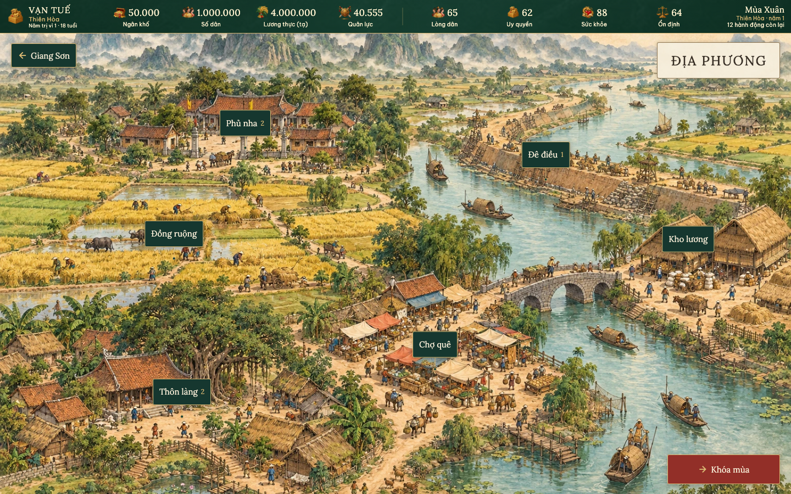

# Địa phương — toàn cảnh và công việc

Từ Giang Sơn, bấm **Địa phương** để mở cảnh làng quê riêng (`locality`), cùng phong cách tranh màu nước và mực trên giấy ngà với Kinh Thành. Sáu điểm bấm mở sáu trang chức năng, có nút **Về Địa phương**. Nút **Giang Sơn** trên toàn cảnh trở lại bản đồ quốc gia.

| Địa điểm | Trang | Chức năng |
| --- | --- | --- |
| Phủ nha | Điều hành địa phương | Tấu báo, lối giao việc theo lĩnh vực, quan phụ trách và tiến độ công việc địa phương |
| Đồng ruộng | Nông nghiệp | Cấp nông nghiệp, dự kiến thu hoạch, khai khẩn và phát triển nông nghiệp |
| Đê điều | Trị thủy | Tình trạng đê, hao mòn, bảo dưỡng, tu bổ và nâng cấp |
| Kho lương | Lương thực & Cứu tế | Dự trữ, khẩu phần, bổ sung kho, mở kho cứu tế, bán lương dư và ưu tiên chi trả |
| Chợ quê | Thương chính | Thuế, ưu tiên sản xuất, thương mại, truy thu và phát triển kinh tế |
| Thôn làng | Dân cư & Lao động | Dân cư, lao động, sản xuất, biến động; lập ấp, tiếp nhận tị nạn, hồi hương và phòng dịch |

## Phân biệt Phủ nha và Phủ Bá Quan

**Phủ Bá Quan** ở Kinh Thành tiếp tục quản lý con người và chức vụ: hồ sơ, tuyển dụng, bổ nhiệm, bãi nhiệm. **Phủ nha** điều hành công việc: chỉ liệt kê quan đang được giao công việc địa phương có trong sổ tiến độ. Không sao chép danh sách toàn bộ quan hoặc tạo hệ thống nhân sự mới.

Bấm tên quan ở Phủ nha mở cùng hộp hồ sơ được dùng ở Phủ Bá Quan. Liên kết **Đến Phủ Bá Quan** mở trang quản lý nhân sự hiện có, kèm nút **Về Phủ nha**. Các lối giao việc tại Phủ nha mở lĩnh vực tương ứng để chọn công việc, quan phụ trách và xác nhận.

## Dữ liệu và thao tác

- HUD, ngày tháng, hành động và tài nguyên đọc trực tiếp từ bản lưu hiện tại. Không có số liệu hoặc tấu báo minh họa trong giao diện thật.
- Số cạnh nhãn địa điểm là số tấu báo đang chờ liên quan. Phủ nha tập hợp các tấu báo địa phương; mỗi tấu có thể thuộc nhiều lĩnh vực nhưng chỉ xuất hiện một lần trong danh sách Phủ nha. Danh sách xếp theo hạn xử lý. Mở tấu dùng hộp Ngự phê hiện có.
- Giao việc dùng lại `_performAction`, điều kiện khóa, chọn quan, chi phí, xác suất và xác nhận của game. Chưa xác nhận thì không trừ hành động, tiền hoặc lương.
- Chính sách thuế, ưu tiên chi trả và sản xuất dùng cùng lệnh với Ngân khố. Thay chính sách tốn 1 hành động như hiện tại; giao diện hiển thị thời điểm áp dụng.
- Sổ tiến độ lọc công trình, kết quả chờ và đợt dân cư theo lĩnh vực. Công trình nâng cấp bị gián đoạn có lối chọn người thay, dùng quy tắc không cấp vốn lại hiện có.
- Phủ nha có lối mở sổ kết quả chung của triều đình.
- Toàn cảnh giữ HUD, Khóa mùa/Sang tuần và Chong đèn làm thêm. Các lệnh chuyển kỳ/làm thêm được xử lý bởi game shell hiện có; nút bị khóa khi đang lưu.
- Điều hướng và xem hồ sơ không ghi bản lưu hay tiêu hành động. Không đổi engine, schema, bộ luật hoặc nhóm thành tích.
- Bản lưu cũ vẫn mở được sáu trang. Nội dung theo mùa và dân số chỉ hiển thị khi bản lưu hỗ trợ; Thôn làng giải thích khi bản lưu chưa có dữ liệu dân số.
- Màn hẹp kéo ngang; cửa sổ thấp cuộn dọc cảnh. Các nhãn và đầu chấm đi cùng tranh, giữ đúng vị trí khi cuộn. Điểm bấm tối thiểu 44 px, giống Kinh Thành.

## Tệp và tài nguyên

- `lib/game/presentation/widgets/locality_hub.dart`: toàn cảnh, nhãn địa điểm, HUD và nút chuyển kỳ.
- `lib/game/presentation/widgets/locality_routes.dart`: sáu điểm đến và nhóm công việc/tấu báo của từng lĩnh vực.
- `lib/game/presentation/widgets/locality_panel.dart`: nội dung các trang chức năng.
- `lib/game/presentation/game_app.dart`: nối điều hướng và dùng lại lệnh, Ngự phê, hồ sơ quan.
- `assets/images/dia-phuong-watercolor.webp`: tranh nền không chữ, 1536 × 1024, khoảng 755 KiB, đóng gói để chơi offline. Dùng tranh đã tạo bằng image_gen trong bước mockup được duyệt; chuyển WebP chất lượng 90. Không tải ảnh từ mạng.
- `test/locality_hub_test.dart`: điều hướng, bảo toàn bản lưu, xác nhận giao việc, hồ sơ chung, chính sách, tấu báo, khóa mùa và khóa thao tác lúc lưu.
- `tools/locality_visual_test.dart`: render widget thật với font và tài nguyên đóng gói.



## Kiểm tra

```sh
flutter analyze
flutter test --reporter expanded
flutter test tools/locality_visual_test.dart --reporter expanded
flutter build web --release --no-web-resources-cdn
```

Log và ảnh giao diện được lưu trong `output/dia-phuong-implementation/`.

Kết quả ngày 31/10/2026: `flutter analyze` không có lỗi/cảnh báo; toàn bộ 776 kiểm thử đạt; 5 bài render đạt (toàn cảnh ở 5 kích thước, thêm cả 6 trang chi tiết ở 1440 px và 320 px); build web release thành công. Đã thử bản release trong Chrome: đi từ Giang Sơn qua cả sáu địa điểm, sang Phủ Bá Quan và quay về Phủ nha, rồi trở lại Giang Sơn; giữ nguyên 12 hành động, không có lỗi trình duyệt. [Ảnh trình duyệt](../output/dia-phuong-implementation/browser-locality.png).
